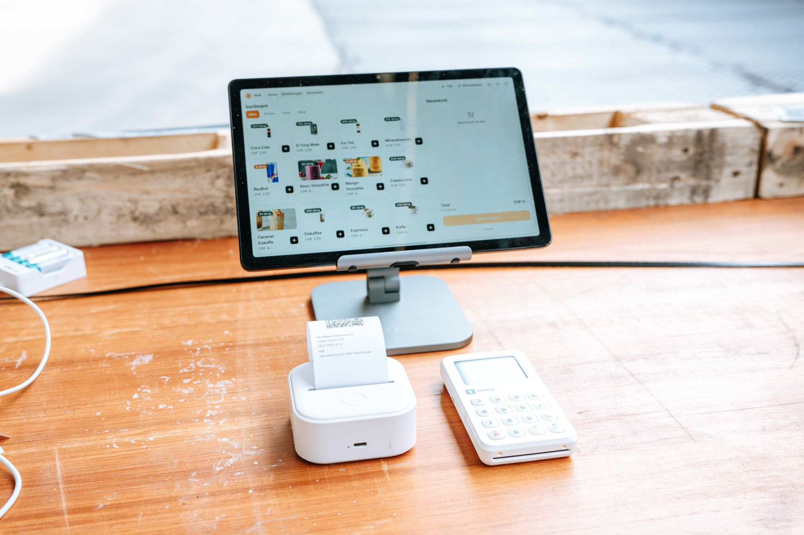
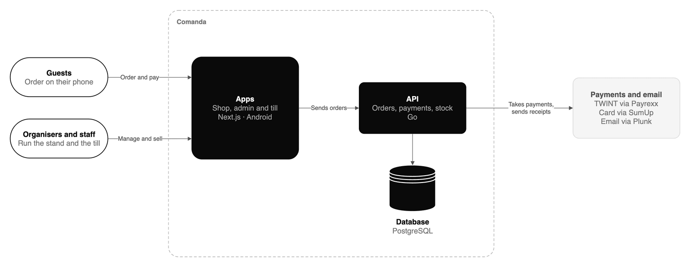

<p align="center">
  <picture>
    <source media="(prefers-color-scheme: dark)" srcset=".github/assets/logo-dark.png">
    
  </picture>
</p>

<h1 align="center">Comanda</h1>

<p align="center">
  Comanda is a till and phone ordering system for food stands at events.<br>
  Guests order and pay with TWINT on their phone, and everyone else pays at a tablet.
</p>

<p align="center">
  <a href="LICENSE"></a>
  
  
  
</p>

<p align="center">
  <a href="https://comanda.leys.ch">Website</a> ·
  <a href="https://www.leys.ch/blog/building-a-checkout-system-at-16">How it started</a> ·
  <a href="#run-it-locally">Run it locally</a> ·
  <a href="CONTRIBUTING.md">Contributing</a>
</p>

<br>

<p align="center">
  
  <br>
  <sub>The till at a five-day festival. The printer cost 30 francs and thinks it's printing stickers.</sub>
</p>

## What it is

A guest scans the QR code at the stand, orders on their phone and pays with TWINT. The order shows up at the stand, and the guest gets a pickup code to show at the window. People who want to pay cash or by card go to the till, which is an Android tablet with a SumUp card reader.

Each organiser has their own shop with their logo, colours and domain, and their own Payrexx and SumUp accounts.

I built it after watching the queue at a monthly youth event grow because the old till app was slow. It ran there first, and in July 2026 it ran a five-day festival.

| Number | From the events so far |
| --: | :-- |
| **4,051** | orders in five festival days |
| **95 %** | paid with TWINT. The card readers were almost decorative. |
| **0** | burgers sold after they had run out |
| **415,000** | requests, of which 22 ended in a server error |

## How a stand runs

1. **Ordering.** The guest scans the QR code at the stand, picks from the menu and pays with TWINT. They don't need to install an app.
2. **Pickup.** After paying, the guest has a pickup code on their phone. The pickup station scans it. The code contains the signed order, so the scan works when the festival Wi-Fi is down.
3. **The till.** Cash and card payments go through the tablet. Receipts come out of a Bluetooth thermal printer.
4. **Stock.** When the last burger is sold, guests can't order it anymore. After the event, the organiser downloads every sale as an Excel file.

A few features came from specific events: a deposit on reusable cups that is refunded through the original TWINT payment, printed vouchers for artists, free meals for helpers, and a separate Android build per organiser so two organisers can share one tablet.

## What it doesn't do

Comanda is for stands that sell for a few hours or a few days. It has no tables, tabs or reservations, so a restaurant is better served by a restaurant POS. The till runs on Android only. There is no self-service sign-up: I set up each organiser by hand.

If you want a till you can buy today and run without me, SumUp's own POS and Lightspeed are solid and come with a support team, which Comanda doesn't have. Comanda makes sense when you want phone ordering with TWINT at a stand, under your own name.

## Architecture

<p align="center">
  
</p>

<sub>Source: <a href=".github/assets/architecture.drawio"><code>.github/assets/architecture.drawio</code></a>. Open it in draw.io to edit it.</sub>

The API decides which organiser a request belongs to from the domain it came in on. PostgreSQL row-level security keeps each organiser's rows apart, so a bug in the app can't show one organiser another organiser's data. Payment credentials are encrypted before they're stored.

## Where to find things

| Folder | What's inside |
| :-- | :-- |
| [`backend/`](backend/README.md) | Go API: tenancy and row-level security, orders, payments, stock, plugins |
| [`web/`](web/README.md) | Next.js app: storefront, admin, till screens, pickup station, organiser hub, marketing site |
| [`android/`](android/README.md) | Till app: a WebView shell with SumUp and receipt printing |
| [`docs/`](docs/README.md) | Documentation site with the admin handbook and developer guide |

<details>
<summary><b>Routes in the web app</b></summary>

| Path | Who uses it | What for |
| :-- | :-- | :-- |
| `/` | Guests | The organiser's storefront with menu, cart, TWINT checkout and pickup code. On the platform host it's the marketing site. |
| `/admin` | Organisers | Products, bundles, categories, stock, orders, refunds and the sales export |
| `/pos` | Cashiers | The till for cash, card and TWINT |
| `/station` | Helpers | The pickup station, which scans pickup codes |
| `/account`, `/t/` | Organisers | Branding, domains, Payrexx, SumUp and invites |
| `/platform-admin` | Platform | Setting up new organisers |

Optional features are plugins in this repo, switched on per organiser: **staff-perks** gives helpers free meals, **artist-voucher** prints vouchers for artists and outreach, **club100** handles member benefits, and **stationqr** sets up a pickup station from a QR code.

</details>

<details>
<summary><b>Tech stack</b></summary>

| Part | Built with |
| :-- | :-- |
| Backend | Go 1.26, Chi, Ent, Atlas migrations, Uber FX, oapi-codegen |
| Web | Next.js 16, React 19, TypeScript, Tailwind CSS 4, Radix UI |
| Android | Kotlin, Jetpack Compose, SumUp SDK, ZXing, Bluetooth thermal printing |
| Sign-in | Better Auth with organisations, email codes and Google |
| Payments | Payrexx (TWINT), SumUp (card), cash, deposits and refunds |
| Data | PostgreSQL with row-level security behind PgBouncer, S3-compatible object storage |
| Infrastructure | Hetzner K3s, ArgoCD, Traefik, cert-manager, Scaleway, Doppler |
| Monitoring | Sentry, OpenTelemetry, Zap |

</details>

## Run it locally

You need Go 1.26 or newer, Node.js 22 or newer with pnpm, Docker and [just](https://just.systems/).

Start the backend in one terminal:

```bash
cd backend
cp .env.example .env
just up                                 # starts Postgres, MinIO and Mailpit
just bootstrap-local you@example.com    # runs migrations, loads a demo catalog, creates your admin user
just dev                                # serves the API on http://localhost:8080
```

Start the web app in a second terminal:

```bash
cd web
pnpm install
pnpm dev                                # serves the app on http://localhost:3000
```

Open http://localhost:3000/login and sign in with the email address you passed to `bootstrap-local`. The sign-in code arrives in Mailpit at http://localhost:8025.

<details>
<summary><b>Running the tests</b></summary>

```bash
cd backend && just test               # unit tests
cd backend && just test-integration   # row-level security and integration tests, needs Postgres
cd web && pnpm typecheck && pnpm lint && pnpm test
cd web && pnpm e2e:headless           # Playwright
```

</details>

## Releases

Pull requests run `pr-checks.yml`, which only checks the parts of the repo that changed and ends in one "All checks" job.

Every merge to `main` runs `main.yml`. It runs the same checks, builds images for the parts that changed and pushes them to GHCR tagged with the commit SHA. Staging gets the new images right away through the gitops repository, and Argo CD rolls them out. The production job then waits for approval on the `production` environment. Approving it ships whatever staging runs. Cancelling the run skips production. To roll back, pin an earlier digest in the gitops repository.

Android builds are manual. Run `android-release.yml` for staging or production, and leave the version empty to get the next patch version. The release lands on GitHub Releases, and the tablets update themselves from there.

## Contributing and security

Pull requests are welcome. Please read [CONTRIBUTING.md](CONTRIBUTING.md) first, and report vulnerabilities privately as described in [SECURITY.md](SECURITY.md).

## License

Comanda is source-available under the [Business Source License 1.1](LICENSE). That is not an OSI open source license.

- Individuals, non-profits, schools and organisations with fewer than 50 people and less than USD 5M annual revenue can use it for free, including in production at their own events.
- Nobody can offer Comanda to others as a hosted or managed service, or build it into a product they sell, without a commercial license.
- Larger organisations need a commercial license for production use. Write to contact@leys.ch.
- Each version becomes GNU AGPL v3.0 or later four years after it's published.

You can always read the code, change it and run it to develop, test or try it out.

<br>

<p align="center">
  <sub>Built by Levyn Schneider in Mühlethurnen, Switzerland. The long version is on the <a href="https://www.leys.ch/blog">blog</a>.</sub>
</p>
